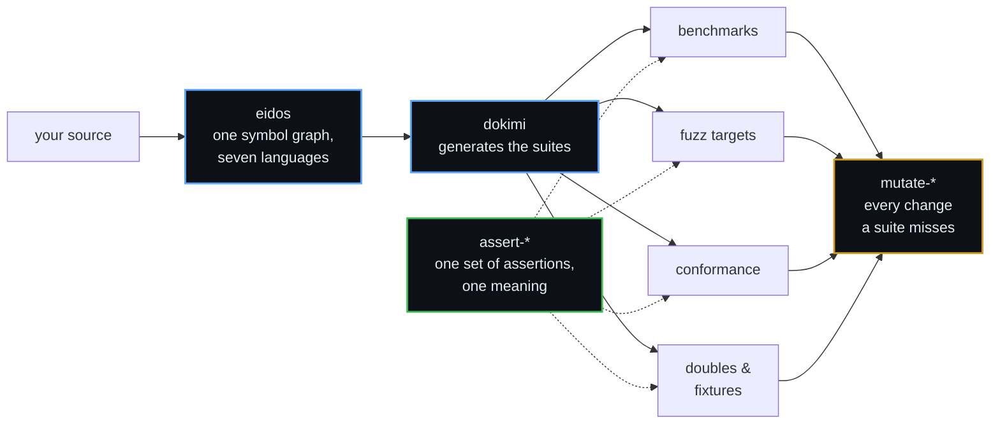

<div align="center">

# δοκιμασία

**In Athens, the dokimasia was the scrutiny that an official passed before taking office.**

<sub>We build the infrastructure for testing software that has to be right.</sub>

</div>

---

## Why we build this

A test suite that cannot fail proves nothing. Writing more tests adds more confidence of the same
kind. We break each check on purpose before we release it and require it to fail. On code whose own
suite already passed, this practice has found these defects:

- a seat that lost three failures in four under concurrency,
- a conformance reader that ignored whole case files,
- a suite that checked its answers with the library that it tested.

---

## 🧪 dokimi: tests that prove they can fail

**[dokimi](https://github.com/dokimasia/dokimi)** generates the tests and the test helpers of your Go
code from directives in its doc comments. It proves that each check that it writes can fail.

A test that cannot fail looks the same as a test that works, because both pass. dokimi pairs each
check with a **planted defect**: an implementation that is correct except for the one rule that its
check verifies. `go test` runs each check against its planted defect and fails when the check passes
on it.

```go
// Store keeps items by key.
//
//dokimi:suite
//dokimi:stub
type Store interface {
	Put(ctx context.Context, key, item string) error
	Get(ctx context.Context, key string) (string, error)
}

// ReturnsThePutItem checks that Get returns the item that Put stored.
//
//dokimi:check Store.Get defect=forgetful
func ReturnsThePutItem(h *StoreHandle) { … }
```

`dokimi run ./...` writes the conformance suite, the double, and a test for each implementation that
`//dokimi:subject` marks. The generated code is plain Go, and `go test` runs it without dokimi.

dokimi generates:

- **conformance suites** of interfaces, structs and functions, with fuzz targets, allocation budgets
  and a benchmark for each method,
- **doubles** that record each call, return the results that a test configures, and inject faults and
  latency,
- **fixture builders**, the parse and print functions of enumerations, and the specs of error values.

A gate for CI fails the build on a generated file that is out of date. Each release for Linux, macOS
and Windows has signed checksums, SBOMs and build provenance.

```sh
brew install --cask dokimasia/tap/dokimi
```

| | Repository | |
|---|---|---|
| 🧪 | **[dokimi](https://github.com/dokimasia/dokimi)** | The generator and its command line · `v0.6.0` |
| 🔗 | [dokimi-go](https://github.com/dokimasia/dokimi-go) | The runtime that the generated code calls: `conform` runs the suites, `stub` records the calls of the doubles, and `fault` selects the calls that fail |

---

## 🧬 eidos: the engine underneath

dokimi is built on **[eidos](https://github.com/dokimasia/eidos)**, a framework for code generation. A
frontend parses source into a symbol graph that belongs to no language. Plugins annotate the graph and
produce output. A backend renders the output in a target language. A run regenerates only what
changed, writes the same bytes every time, and can write more than one language in one run.

| Language | Reads | Writes |
|---|:---:|:---:|
| Go | ✅ | ✅ |
| TypeScript | ✅ | ✅ |
| Java | ✅ | ✅ |
| Rust | ✅ | ✅ |
| Python | ✅ | ✅ |
| protobuf | ✅ | ✅ |
| GraphQL | ✅ | ✅ |

- **A kernel without a language.** Each language is a satellite module. Satellites never import each
  other, and every conversion between languages goes through the canonical types of the kernel. The
  runtime of the kernel imports the standard library alone.
- **Plugins in Go or in YAML.** A typed plugin uses the SDK facade. A declarative plugin is a YAML
  manifest with templates and needs no Go.
- **Your own binary.** The command kernels `run`, `plan`, `explain`, `prune`, `doctor`, `watch` and
  `schema` give each tool built on eidos the same command line, config file and JSON output.
- **A plugin for buf.** The same composition runs as a protoc plugin under `protoc` and
  `buf generate`.
- **Decisions on record.** The repository records each decision in an RFC or an ADR, and a corpus
  holds the frontend of every language to one set of expectations.

```sh
brew install --cask dokimasia/tap/eidos
```

---

## The toolchain



Teams that write this infrastructure by hand, once per language, each implement what they believe the
specification says. Each of their suites can pass while no test checks whether the implementations
agree. We define the behaviour as data, so a disagreement fails a build. We generate the harnesses
around the definition instead of writing them once per language.

---

## The assertions

The generated suites assert with one set of assertions. The set is defined as data, so a test in Go
means what the same test means in Python, TypeScript, Java or Rust. Each library runs the same cases
against both of its surfaces.

| | Repository | |
|---|---|---|
| 📐 | **[assert-spec](https://github.com/dokimasia/assert-spec)** | The definition: the meaning and the names of each assertion, and the cases that every library runs |
| 🐹 | [assert-go](https://github.com/dokimasia/assert-go) | Go · `v0.11.0` |
| 🐍 | [assert-python](https://github.com/dokimasia/assert-python) | Python |
| 🟦 | [assert-typescript](https://github.com/dokimasia/assert-typescript) | TypeScript |
| ☕ | [assert-java](https://github.com/dokimasia/assert-java) | Java · Kotlin |
| 🦀 | [assert-rust](https://github.com/dokimasia/assert-rust) | Rust |
| 🟪 | assert-csharp | C# · **looking for a maintainer** |

> Go's `cmp` treats a nil slice as equal to an empty slice. Python treats `None` as unequal to `[]`.
> A suite ported from one language to the other passes in both, and the two builds test different
> things.

A library can be correct on its own terms and still disagree with the other libraries. The definition
lives outside the libraries, and each library runs the same cases in its own CI.

---

## Mutation testing

Mutation testing checks the suite itself. A mutant is a small change to your code, such as `a - b`
becoming `a + b`. A suite that still passes against a mutant has not tested that line. The operators
are defined as data, so every engine makes the same mutants and writes the same record of a run.

| | Repository | |
|---|---|---|
| 📜 | **[mutate-spec](https://github.com/dokimasia/mutate-spec)** | The definition: the catalogue of operators and the record of a run |
| 🐹 | [mutate-go](https://github.com/dokimasia/mutate-go) | Go · `dokimi-mutate-go` · `v0.2.0` |
| 🟪 | mutate-csharp | C# · **looking for a maintainer** |
| 🐍 🟦 ☕ 🦀 | mutate-&lt;lang&gt; | Python, TypeScript, Java and Rust · **not started yet, and open to contributors** |

```text
arith.go:7:33: not covered: x * 2 became x / 2 (aor)
arith.go:5:33: survived: a - b became a + b (aor)
fixture: 2 of 6 mutants detected (33%): 2 killed, 2 survived, 2 not covered
```

```sh
go run go.dokimi.dev/mutate/cmd/dokimi-mutate-go@latest ./...
```

The engine of each language is named `dokimi-mutate-<lang>`. A pipeline runs every engine the same
way.

---

## Also from the workshop

We build dokimi and eidos with these tools, and we release each tool on its own.

| | Repository | |
|---|---|---|
| ⚙️ | [ergon](https://github.com/dokimasia/ergon) | Sets up repositories in eleven languages with CI workflows, Makefile targets, linters and hooks, and releases packages from changesets · `v0.16.0` |
| 🧭 | [techne](https://github.com/dokimasia/techne) | An MCP server that gives AI agents the code navigation and refactorings of an IDE in ten languages · `v0.0.3` |
| 🔍 | [lint-go](https://github.com/dokimasia/lint-go) | Go analyzers for error texts without the name of their package and for test skips that expired · `v0.2.0` |

---

## Contribute

The projects are young, and their specifications are open. You can contribute in these ways:

- 🐛 **Report what breaks.** Run dokimi on your own code, and open an issue with the example that fails.
  A failing example is the most useful issue that you can write.
- 🧩 **Write an eidos plugin.** A declarative plugin is a YAML manifest with templates and needs no Go.
- 🌍 **Port a library to a new language.** assert-spec and mutate-spec define their behaviour and its
  cases as data, so a port knows when it is complete. C# has no assertion library yet, and every
  language but Go has no mutation engine yet.
- 🗣️ **Dispute a decision.** dokimi and eidos record their decisions in RFCs and ADRs under `docs/`. Open
  an issue when you think that a decision is wrong.

The `CONTRIBUTING.md` of each project states its build, its checks and its review.

---

## House rules

```
Determinism first          The same input gives the same bytes.
Mutate every check         Break each check, watch it fail, and restore it. Record that
                           in the commit.
Never judge with the       A runner that checks its answers with the library under test
subject                    checks nothing.
Declare divergence         A language that cannot comply states so, with a reason that
                           can be disputed.
A failure is a record      A failure states named values, not prose to search.
```

---

## The names

| | Greek | Meaning |
|---|---|---|
| **dokimasia** | δοκιμασία | the scrutiny before office |
| **dokimi** | δοκιμή | the trial itself |
| **eidos** | εἶδος | the form, before any language gives it syntax |
| **ergon** | ἔργον | the work |
| **techne** | τέχνη | the craft |

---

<div align="center">
<sub>

dokimi `v0.6.0` · eidos below 1.0 · assert-go, mutate-go, ergon, techne and lint-go released · the other assertion libraries unpublished<br>
Built by **[ThesmOS](https://github.com/thesm-os)** · dokimi and eidos under Apache-2.0 · the libraries under MIT

</sub>
</div>
