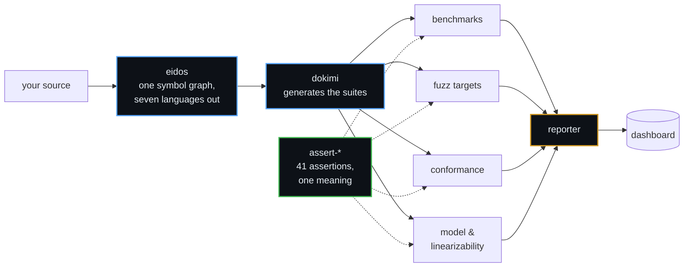

<div align="center">

# δοκιμασία

**The scrutiny an Athenian official passed before taking office.**<br>
Not a report on what was done — the examination a thing submits to
before it is trusted.

<sub>Infrastructure for testing software that has to be right.</sub>

</div>

---

## Not more tests. Better evidence.

A suite that cannot fail proves nothing, and most of them cannot. Every
gate here is broken on purpose before it ships, and required to go red.

---

## How the parts fit



---

## The assertions

One set, defined as data, so the same test means the same thing in every
language that implements it. `41` assertions · `87` corpus cases · run
against **both** surfaces in **every** language.

| | Repository | |
|---|---|---|
| 📐 | **[assert-spec](https://github.com/dokimasia/assert-spec)** | The definition — meaning, names, and the cases every library runs |
| 🐹 | [assert-go](https://github.com/dokimasia/assert-go) | Go |
| 🐍 | [assert-python](https://github.com/dokimasia/assert-python) | Python |
| 🟦 | [assert-typescript](https://github.com/dokimasia/assert-typescript) | TypeScript |
| ☕ | [assert-java](https://github.com/dokimasia/assert-java) | Java · Kotlin |
| 🦀 | [assert-rust](https://github.com/dokimasia/assert-rust) | Rust |

> Go's `cmp` says a nil slice equals an empty one. Python says `None`
> does not equal `[]`. Port a suite between them and **both builds go
> green while testing different things.**

---

## House rules

```
Determinism first          Same input, same bytes.
Mutate every check         Break it, watch it go red, restore. Say so in the commit.
Never judge with the       A runner that checks its answers using the library
subject                    under test passes having checked nothing.
Declare divergence         Where a language cannot comply it says so, with a
                           reason someone can argue with.
A failure is a record      Named values, not prose to search for a word.
```

---

## The names

| | Greek | Meaning |
|---|---|---|
| **dokimasia** | δοκιμασία | the scrutiny before office |
| **dokimi** | δοκιμή | the trial itself |
| **eidos** | εἶδος | the form, before any language gives it syntax |

---

<div align="center">
<sub>

Assertions `1.0.0`, five languages, unpublished · eidos and dokimi unreleased<br>
Built by **[ThesmOS](https://github.com/thesm-os)** · MIT

</sub>
</div>
