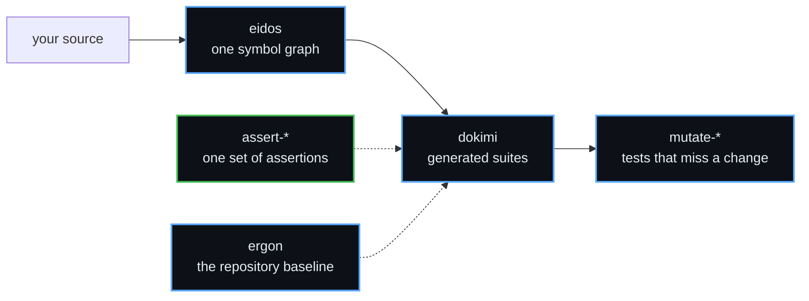

<div align="center">

# δοκιμασία

**The scrutiny an Athenian official passed before taking office.**

Dokimasia builds open-source tools that test software and generate code from one definition for
many languages. Every check that a tool writes must fail on a planted defect before we trust it.

</div>

---

## Start in one minute

```sh
brew install --cask dokimasia/tap/dokimi   # generate tests from directives in Go code
brew install --cask dokimasia/tap/ergon    # set up a repository with CI, linters and releases
brew install --cask dokimasia/tap/techne   # give an AI agent the code navigation of an IDE
go get go.dokimi.dev/assert                # assertions for Go tests
```

Each tool also installs with `go install`. The README of each repository has the details.

---

## What we build

### Tests that can fail

| Repository | What it does | Status |
|---|---|---|
| [dokimi](https://github.com/dokimasia/dokimi) | Generates conformance suites, test doubles, fixture builders and the specs of enumerations and errors from directives in Go code. It proves that each check of a suite fails on its planted defect | v0.6.0 |
| [dokimi-go](https://github.com/dokimasia/dokimi-go) | The Go modules that the code from dokimi calls: suites, stubs and fault injection | released |
| [mutate-go](https://github.com/dokimasia/mutate-go) | Mutation testing for Go. It reports each change to your code that your tests miss | v0.2.0 |
| [mutate-spec](https://github.com/dokimasia/mutate-spec) | Mutation testing defined as data, so every language makes the same mutants | draft |

### One set of assertions for every language

[assert-spec](https://github.com/dokimasia/assert-spec) defines each assertion as data. Every
library runs the same cases in its own CI, so a test means the same thing in each language.

| Language | Repository | Status |
|---|---|---|
| Go | [assert-go](https://github.com/dokimasia/assert-go) | v0.11.0 |
| Python | [assert-python](https://github.com/dokimasia/assert-python) | not released |
| TypeScript | [assert-typescript](https://github.com/dokimasia/assert-typescript) | not released |
| Java and Kotlin | [assert-java](https://github.com/dokimasia/assert-java) | not released |
| Rust | [assert-rust](https://github.com/dokimasia/assert-rust) | not released |
| C# | assert-csharp | **looking for a maintainer** |

### Code generation

| Repository | What it does | Status |
|---|---|---|
| [eidos](https://github.com/dokimasia/eidos) | Parses Go, TypeScript, Java, Rust, Python, protobuf and GraphQL into one symbol graph, and generates code for several languages in one run. It writes the same bytes every time, and it runs as a protoc plugin under `buf generate` | below 1.0 |

### Tools for developers

| Repository | What it does | Status |
|---|---|---|
| [ergon](https://github.com/dokimasia/ergon) | Sets up repositories in eleven languages with CI workflows, Makefile targets, linters and hooks, and releases packages from changesets | v0.16.0 |
| [techne](https://github.com/dokimasia/techne) | An MCP server that gives AI agents the code navigation and refactorings of an IDE in ten languages | v0.0.3 |
| [lint-go](https://github.com/dokimasia/lint-go) | Go analyzers for error texts without the name of their package and for test skips that expired | v0.2.0 |

---

## The toolchain



eidos reads your source. dokimi generates the suites that test it, with the assertions of
assert-spec. Mutation testing then shows each change to your code that those suites miss.

---

## Get involved

We want users, reviewers and contributors. These are the ways in:

- **Try a tool and report what breaks.** Open an issue in its repository. A failing example is the
  most useful issue you can write.
- **Port the assertions to a new language.** assert-spec defines every assertion and its cases as
  data, so a port knows when it is done. C# has no maintainer yet.
- **Write a plugin for eidos.** A declarative plugin is a YAML manifest and templates, without Go.
- **Add a language to techne or ergon.** Each language is a module of its own.
- **Read the specs and argue with them.** Each repository records its decisions in RFCs and ADRs
  under `docs/`. An issue that disputes a decision is welcome.

The `CONTRIBUTING.md` of a repository states its build, its checks and its review rules.

---

## How we work

| Rule | What it means |
|---|---|
| Determinism first | The same input gives the same bytes |
| Mutate every check | We break each check on purpose and watch it fail before we keep it |
| Never judge with the subject | A runner never checks its answers with the library that it tests |
| Declare divergence | Where a language cannot comply, it says so with a reason |
| A failure is a record | A failure states named values, not prose to search |

---

## The names

| | Greek | Meaning |
|---|---|---|
| **dokimasia** | δοκιμασία | the scrutiny before office |
| **dokimi** | δοκιμή | the trial itself |
| **eidos** | εἶδος | the form, before any language gives it syntax |
| **ergon** | ἔργον | the work |
| **techne** | τέχνη | the craft |

---

<div align="center">
<sub>

The libraries are MIT. eidos and dokimi are Apache-2.0.<br>
Built by **[ThesmOS](https://github.com/thesm-os)**

</sub>
</div>
