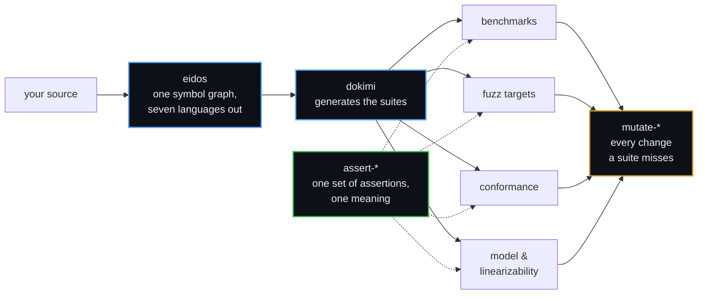

<div align="center">

# δοκιμασία

**The scrutiny an Athenian official passed before taking office.**<br>
Not a report on what was done — the examination a thing submits to
before it is trusted.

<sub>Infrastructure for testing software that has to be right.</sub>

</div>

---

## Not more tests. Better evidence.

A suite that cannot fail proves nothing, and most of them cannot. The
usual answer is to write more tests, which mostly adds more of the same
confidence. Ours is to break every gate on purpose before it ships and
require it to go red — on code whose own suite was already green, that
habit has found a seat losing three failures in four under concurrency,
a conformance reader ignoring whole case files, and a suite checking its
answers with the library it was testing.

---

## Try it in a minute

```sh
brew install --cask dokimasia/tap/dokimi   # tests generated from directives in Go code
brew install --cask dokimasia/tap/ergon    # a repository baseline: CI, linters, hooks, releases
brew install --cask dokimasia/tap/techne   # IDE-grade code navigation for AI agents
go get go.dokimi.dev/assert                # the assertions, in Go
```

---

## How the parts fit



Writing that infrastructure by hand, once per language, is where the
integrity goes. Six teams each implement what they believe the
specification says, every suite passes, and nothing tests whether the
six beliefs agree. So the definition is data rather than prose, because
prose does not fail a build, and the harnesses around it are generated
rather than typed out six times.

eidos parses source into a symbol graph belonging to no language and
renders it into seven — from a source tree, or as a protoc plugin under
`buf generate`. dokimi turns a definition into the suites that exercise
it. The assertion libraries are what those suites assert with, and
mutation testing shows every change to your code that the suites let
through.

---

## The assertions

One set, defined as data, so the same test means the same thing in every
language that implements it — run against **both** surfaces in **every**
language.

| | Repository | |
|---|---|---|
| 📐 | **[assert-spec](https://github.com/dokimasia/assert-spec)** | The definition — meaning, names, and the cases every library runs |
| 🐹 | [assert-go](https://github.com/dokimasia/assert-go) | Go · `v0.11.0` |
| 🐍 | [assert-python](https://github.com/dokimasia/assert-python) | Python |
| 🟦 | [assert-typescript](https://github.com/dokimasia/assert-typescript) | TypeScript |
| ☕ | [assert-java](https://github.com/dokimasia/assert-java) | Java · Kotlin |
| 🦀 | [assert-rust](https://github.com/dokimasia/assert-rust) | Rust |
| 🟪 | assert-csharp | C# — **looking for a maintainer** |

> Go's `cmp` says a nil slice equals an empty one. Python says `None`
> does not equal `[]`. Port a suite between them and **both builds go
> green while testing different things.**

Agreement is not a property any one library can have. A library can be
correct on its own terms and still disagree with its five siblings, so
the definition lives outside all of them and every one runs the same
cases in its own CI.

---

## The rest of the workshop

| | Repository | |
|---|---|---|
| 🧪 | **[dokimi](https://github.com/dokimasia/dokimi)** | Conformance suites, doubles and fixture builders from directives in Go code — and proof that every check can fail · `v0.6.0` |
| 🔗 | [dokimi-go](https://github.com/dokimasia/dokimi-go) | The runtime the generated code calls: suites, stubs, fault injection |
| 🧬 | **[eidos](https://github.com/dokimasia/eidos)** | One symbol graph from Go, TypeScript, Java, Rust, Python, protobuf and GraphQL; code for several languages in one run, byte-identical warm or cold |
| 🦠 | [mutate-go](https://github.com/dokimasia/mutate-go) | Mutation testing for Go — every change your tests miss · `v0.2.0` |
| 📜 | [mutate-spec](https://github.com/dokimasia/mutate-spec) | Mutation testing defined as data, so every engine makes the same mutants |
| ⚙️ | [ergon](https://github.com/dokimasia/ergon) | A managed baseline for repositories in eleven languages: CI, Makefile, linters, hooks, releases from changesets · `v0.16.0` |
| 🧭 | [techne](https://github.com/dokimasia/techne) | An MCP server that gives AI agents an IDE's navigation and refactorings in ten languages · `v0.0.3` |
| 🔍 | [lint-go](https://github.com/dokimasia/lint-go) | Analyzers for error texts without their package and test skips that expired · `v0.2.0` |

---

## Come build it with us

The tools are young and the specifications are open. The fastest way in:

- 🐛 **Break something.** Run a tool on your own code and open an issue with what went wrong. A failing example is worth more than a page of description.
- 🌍 **Bring a language.** assert-spec defines every assertion and its cases as data, so a port knows exactly when it is done. C# is waiting for someone.
- 🧩 **Write an eidos plugin.** A declarative plugin is a YAML manifest and templates — no Go needed.
- 🗣️ **Argue with a decision.** Every repository records its reasoning in RFCs and ADRs under `docs/`. An issue that says one is wrong is welcome.

Each project's `CONTRIBUTING.md` has its build, its checks and how review works.

---

## House rules

```
Determinism first          Same input, same bytes.
Mutate every check         Break it, watch it go red, restore. Say so in the commit.
Never judge with the       A runner that checks its answers using the library
subject                    under test passes having checked nothing.
Declare divergence         Where a language cannot comply it says so, with a
                           reason someone can argue with.
A failure is a record      Named values, not prose to search for a word.
```

---

## The names

| | Greek | Meaning |
|---|---|---|
| **dokimasia** | δοκιμασία | the scrutiny before office |
| **dokimi** | δοκιμή | the trial itself |
| **eidos** | εἶδος | the form, before any language gives it syntax |
| **ergon** | ἔργον | the work |
| **techne** | τέχνη | the craft |

---

<div align="center">
<sub>

assert-go, dokimi, mutate-go, ergon, techne and lint-go released · eidos below 1.0 · the other assertion libraries unpublished<br>
Built by **[ThesmOS](https://github.com/thesm-os)** · libraries MIT · eidos and dokimi Apache-2.0

</sub>
</div>
