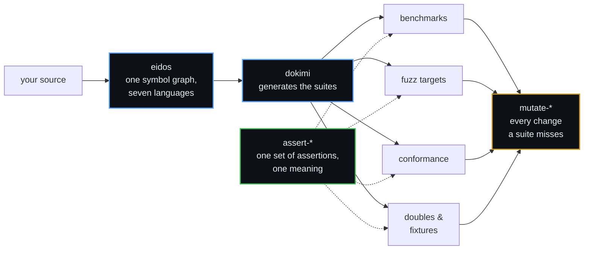

<div align="center">

# δοκιμασία

**The scrutiny an Athenian official passed before taking office.**<br>
Not a report on what was done — the examination a thing submits to
before it is trusted.

<sub>Infrastructure for testing software that has to be right.</sub>

</div>

---

## Not more tests. Better evidence.

A suite that cannot fail proves nothing, and most of them cannot. The
usual answer is to write more tests, which mostly adds more of the same
confidence. Ours is to break every gate on purpose before it ships and
require it to go red — on code whose own suite was already green, that
habit has found a seat losing three failures in four under concurrency,
a conformance reader ignoring whole case files, and a suite checking its
answers with the library it was testing.

---

## 🧪 dokimi — tests that prove they can fail

**[dokimi](https://github.com/dokimasia/dokimi)** generates the tests and
the test helpers of your Go code from directives in its doc comments —
and then proves that every check it wrote can fail.

A test that cannot fail looks exactly like a test that works, because
both pass. So dokimi pairs each check with a **planted defect**: an
implementation that is correct except for the one rule its check
verifies. `go test` runs every check against its defect and fails when
the check passes on it.

```go
// Store keeps items by key.
//
//dokimi:suite
//dokimi:stub
type Store interface {
	Put(ctx context.Context, key, item string) error
	Get(ctx context.Context, key string) (string, error)
}

// ReturnsThePutItem checks that Get returns the item that Put stored.
//
//dokimi:check Store.Get defect=forgetful
func ReturnsThePutItem(h *StoreHandle) { … }
```

`dokimi run ./...` writes the conformance suite, the double and a test
for every implementation marked `//dokimi:subject`. The generated code
is plain Go that `go test` runs without dokimi.

- **Conformance suites** of interfaces, structs and functions, with fuzz
  targets, allocation budgets and benchmarks for every method
- **Doubles** that record each call, return what a test configures, and
  inject faults and latency
- **Fixture builders**, the parse and print functions of enumerations,
  and the specs of error values
- **A CI gate** that fails the build on a generated file that is out of
  date
- **Signed releases** for Linux, macOS and Windows, with SBOMs and build
  provenance

```sh
brew install --cask dokimasia/tap/dokimi
```

| | Repository | |
|---|---|---|
| 🧪 | **[dokimi](https://github.com/dokimasia/dokimi)** | The generator and its command line · `v0.6.0` |
| 🔗 | [dokimi-go](https://github.com/dokimasia/dokimi-go) | The runtime the generated code calls: `conform` runs the suites, `stub` records the calls of the doubles, `fault` selects the calls that fail |

---

## 🧬 eidos — the engine underneath

dokimi is built on **[eidos](https://github.com/dokimasia/eidos)**, a
code-generation framework in its own right. A frontend parses source
into a symbol graph that belongs to no language. Plugins annotate that
graph and produce output. A backend renders it into a target language.
One run regenerates only what changed, writes the same bytes every time,
and can target several languages at once.

| Language | Reads | Writes |
|---|:---:|:---:|
| Go | ✅ | ✅ |
| TypeScript | ✅ | ✅ |
| Java | ✅ | ✅ |
| Rust | ✅ | ✅ |
| Python | ✅ | ✅ |
| protobuf | ✅ | ✅ |
| GraphQL | ✅ | ✅ |

- **One kernel, no language inside.** Every language is a satellite
  module. Satellites never import each other, and everything that
  crosses languages goes through the kernel's canonical types. The
  kernel's runtime imports the standard library alone.
- **Plugins two ways.** Typed plugins in Go on a stable SDK facade, or
  declarative plugins — a YAML manifest and templates, no Go needed.
- **Your binary, not ours.** The command kernels (`run`, `plan`,
  `explain`, `prune`, `doctor`, `watch`, `schema`) give every tool built
  on eidos the same command line, config file and JSON output.
- **Under buf too.** The same composition runs as a protoc plugin under
  `protoc` and `buf generate`.
- **Specified first.** Every decision is an RFC or an ADR in the
  repository, and a cross-language conformance corpus holds every
  frontend to one set of expectations.

```sh
brew install --cask dokimasia/tap/eidos
```

---

## How the parts fit



Writing that infrastructure by hand, once per language, is where the
integrity goes. Six teams each implement what they believe the
specification says, every suite passes, and nothing tests whether the
six beliefs agree. So the definition is data rather than prose, because
prose does not fail a build, and the harnesses around it are generated
rather than typed out six times.

---

## The assertions

What the generated suites assert with. One set, defined as data, so the
same test means the same thing in every language that implements it —
run against **both** surfaces in **every** language.

| | Repository | |
|---|---|---|
| 📐 | **[assert-spec](https://github.com/dokimasia/assert-spec)** | The definition — meaning, names, and the cases every library runs |
| 🐹 | [assert-go](https://github.com/dokimasia/assert-go) | Go · `v0.11.0` |
| 🐍 | [assert-python](https://github.com/dokimasia/assert-python) | Python |
| 🟦 | [assert-typescript](https://github.com/dokimasia/assert-typescript) | TypeScript |
| ☕ | [assert-java](https://github.com/dokimasia/assert-java) | Java · Kotlin |
| 🦀 | [assert-rust](https://github.com/dokimasia/assert-rust) | Rust |
| 🟪 | assert-csharp | C# — **looking for a maintainer** |

> Go's `cmp` says a nil slice equals an empty one. Python says `None`
> does not equal `[]`. Port a suite between them and **both builds go
> green while testing different things.**

Agreement is not a property any one library can have. A library can be
correct on its own terms and still disagree with its five siblings, so
the definition lives outside all of them and every one runs the same
cases in its own CI.

---

## Mutation testing

The same idea, turned on your suite. A mutant is a small change to your
code — `a - b` becomes `a + b` — and a suite that still passes has not
tested that line. The operators are defined as data, so every engine
makes the same mutants and writes the same record of a run.

| | Repository | |
|---|---|---|
| 📜 | **[mutate-spec](https://github.com/dokimasia/mutate-spec)** | The definition — the operator catalogue and the record of a run |
| 🐹 | [mutate-go](https://github.com/dokimasia/mutate-go) | Go · `dokimi-mutate-go` · `v0.2.0` |
| 🟪 | mutate-csharp | C# — **looking for a maintainer** |
| 🐍 🟦 ☕ 🦀 | mutate-&lt;lang&gt; | Python, TypeScript, Java, Rust — **not started, come build one** |

```text
arith.go:7:33: not covered: x * 2 became x / 2 (aor)
arith.go:5:33: survived: a - b became a + b (aor)
fixture: 2 of 6 mutants detected (33%): 2 killed, 2 survived, 2 not covered
```

```sh
go run go.dokimi.dev/mutate/cmd/dokimi-mutate-go@latest ./...
```

Every engine of the standard is named `dokimi-mutate-<lang>`, so a
pipeline that runs one runs them all.

---

## Also from the workshop

The tools we build these with, released on their own.

| | Repository | |
|---|---|---|
| ⚙️ | [ergon](https://github.com/dokimasia/ergon) | A managed baseline for repositories in eleven languages: CI, Makefile, linters, hooks, releases from changesets · `v0.16.0` |
| 🧭 | [techne](https://github.com/dokimasia/techne) | An MCP server that gives AI agents an IDE's navigation and refactorings in ten languages · `v0.0.3` |
| 🔍 | [lint-go](https://github.com/dokimasia/lint-go) | Analyzers for error texts without their package and test skips that expired · `v0.2.0` |

---

## Come build it with us

The tools are young and the specifications are open. The fastest way in:

- 🐛 **Break something.** Run dokimi on your own code and open an issue with what went wrong. A failing example is worth more than a page of description.
- 🧩 **Write an eidos plugin.** A declarative plugin is a YAML manifest and templates — no Go needed.
- 🌍 **Bring a language.** assert-spec and mutate-spec define their behaviour and its cases as data, so a port knows exactly when it is done. C# is waiting for an assertion library, and every language but Go for a mutation engine.
- 🗣️ **Argue with a decision.** dokimi and eidos record their reasoning in RFCs and ADRs under `docs/`. An issue that says one is wrong is welcome.

Each project's `CONTRIBUTING.md` has its build, its checks and how review works.

---

## House rules

```
Determinism first          Same input, same bytes.
Mutate every check         Break it, watch it go red, restore. Say so in the commit.
Never judge with the       A runner that checks its answers using the library
subject                    under test passes having checked nothing.
Declare divergence         Where a language cannot comply it says so, with a
                           reason someone can argue with.
A failure is a record      Named values, not prose to search for a word.
```

---

## The names

| | Greek | Meaning |
|---|---|---|
| **dokimasia** | δοκιμασία | the scrutiny before office |
| **dokimi** | δοκιμή | the trial itself |
| **eidos** | εἶδος | the form, before any language gives it syntax |
| **ergon** | ἔργον | the work |
| **techne** | τέχνη | the craft |

---

<div align="center">
<sub>

dokimi `v0.6.0` · eidos below 1.0 · assert-go, mutate-go, ergon, techne and lint-go released · the other assertion libraries unpublished<br>
Built by **[ThesmOS](https://github.com/thesm-os)** · dokimi and eidos Apache-2.0 · libraries MIT

</sub>
</div>
